# Laporan Praktikum Pemrograman Mobile

**Nama**        : Afkar Aufaa Farros  
**NIM**         : H1D024085  
**Shift**       : Awal E / Akhir C  
**Praktikum**   : Pemrograman Mobile

---

## 📝 Tugas Pertemuan 2
**Tanggal**: Selasa, 27 Oktober 2026

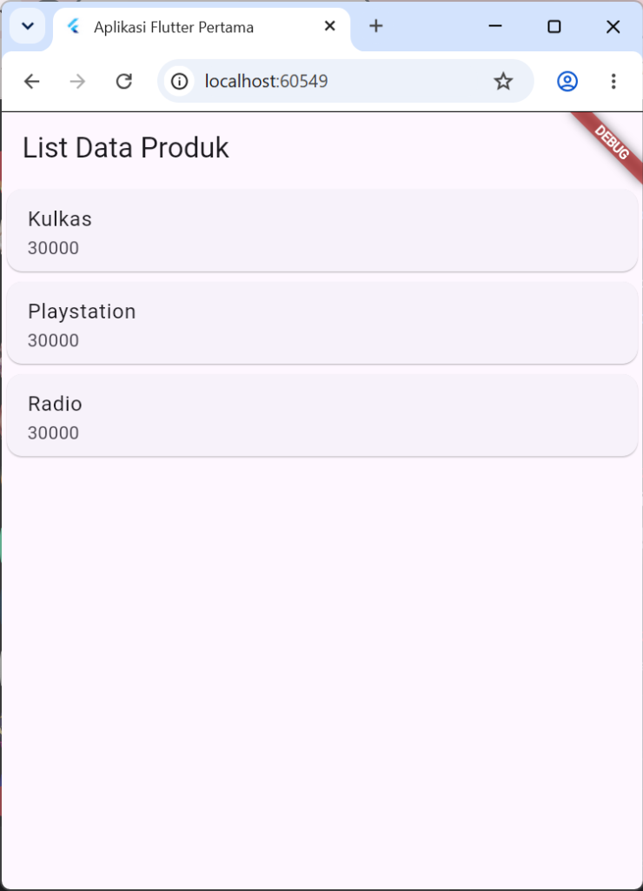

**Kesimpulan Praktikum:**  
Pada pertemuan kedua, praktikum mempelajari konsep dasar antarmuka pengguna (*User Interface*) dan pengaturan tata letak (*layout*) pada Flutter. Materi mencakup penggunaan widget tata letak dasar seperti `Row` dan `Column`, pembuatan antarmuka formulir input produk dengan `TextField`, serta penyajian data produk ke dalam bentuk daftar yang terstruktur dan rapi menggunakan `ListView`, `Card`, dan `ListTile`.

---

## 📝 Tugas Pertemuan 3
**Tanggal**: Selasa, 3 November 2026

| Login Page | Home Page | Side Menu |
| :---: | :---: | :---: |
| 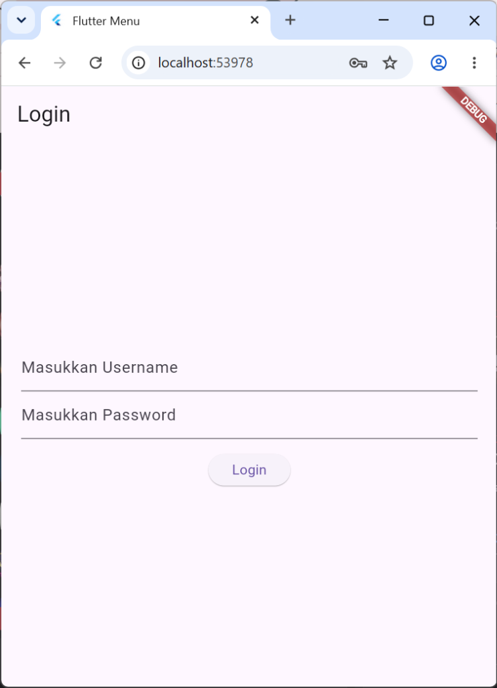 | 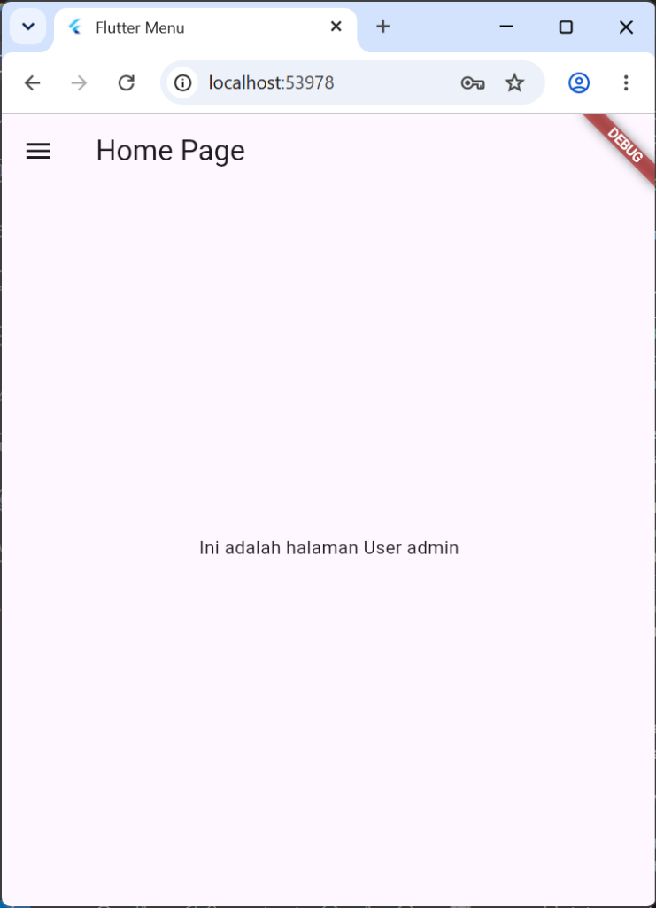 | 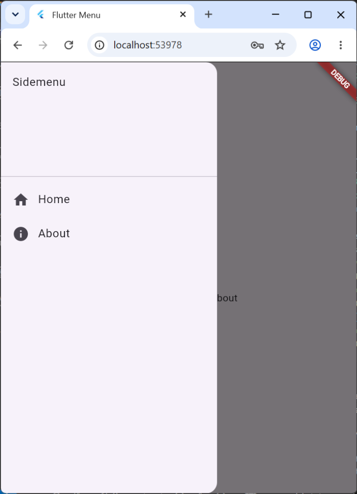 |

**Kesimpulan Praktikum:**  
Pada pertemuan ketiga, praktikum membahas tentang navigasi routing (*Routes*), pembuatan menu samping (*Side Menu / Drawer*), sistem otentikasi sederhana (*Login*), serta penyimpanan data lokal menggunakan *package* `shared_preferences`. Melalui praktikum ini, mahasiswa mempelajari cara mengelola form login, menyimpan dan membaca data username dari *local storage*, serta menghubungkan navigasi antarhalaman menggunakan `Navigator.push` dan menu navigasi `Drawer` pada aplikasi Flutter.

---

## 📝 Tugas Pertemuan 4
**Tanggal**: Selasa, 10 November 2026

| Halaman Registrasi | Halaman Login |
| :---: | :---: |
| 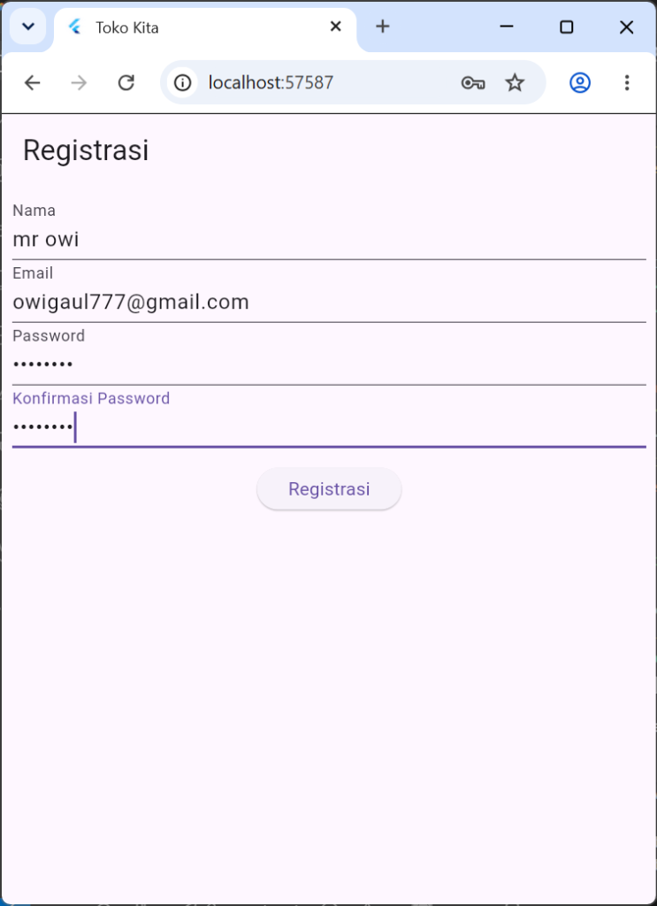 | 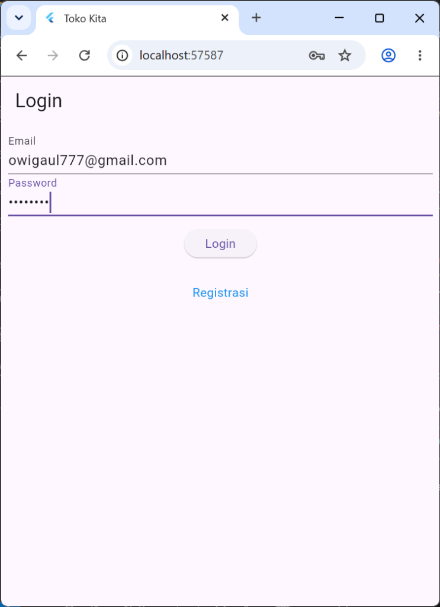 |

| Form Tambah Produk | Detail Produk |
| :---: | :---: |
| 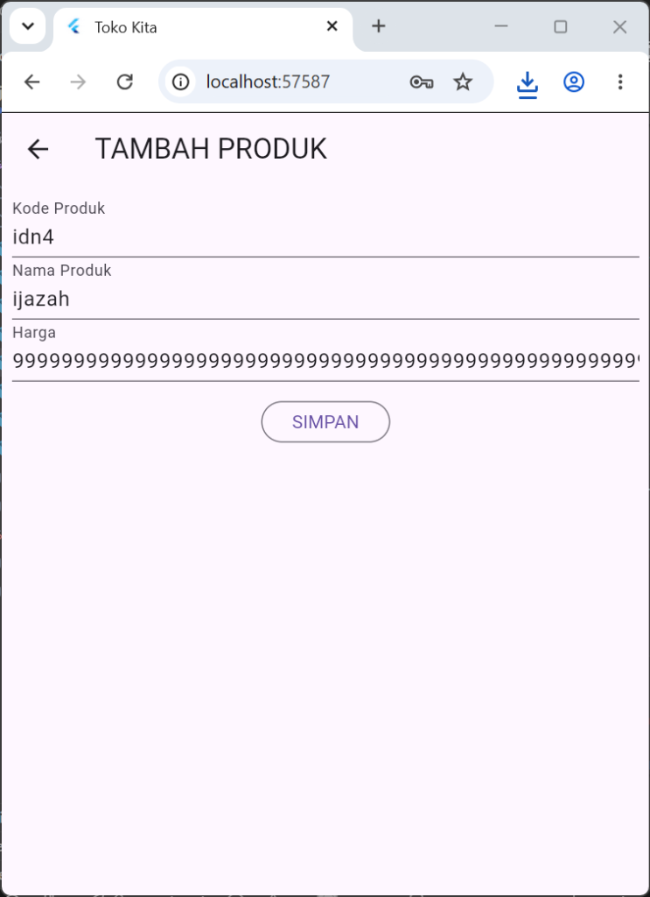 | 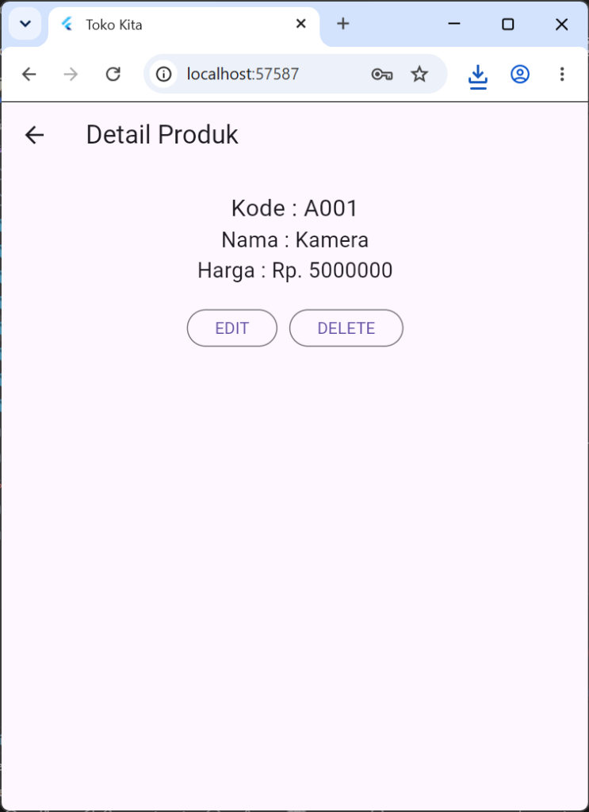 |

**Kesimpulan Praktikum:**  
Pada pertemuan keempat, praktikum mempelajari pembangunan layanan RESTful API menggunakan framework CodeIgniter 4 dengan database MySQL (`toko_api`) serta pengujian endpoint menggunakan Postman. Selain sisi backend, mahasiswa juga merancang model data (`Login`, `Registrasi`, `Produk`) dan antarmuka aplikasi *Toko Kita* di Flutter meliputi halaman Registrasi dengan validasi input, halaman Login, List Produk, Detail Produk, serta Form Tambah dan Ubah Produk.

---

## 📝 Tugas Pertemuan 5
**Tanggal**: Selasa, 17 November 2026

| Dialog Registrasi Berhasil | Dialog Login Gagal |
| :---: | :---: |
| 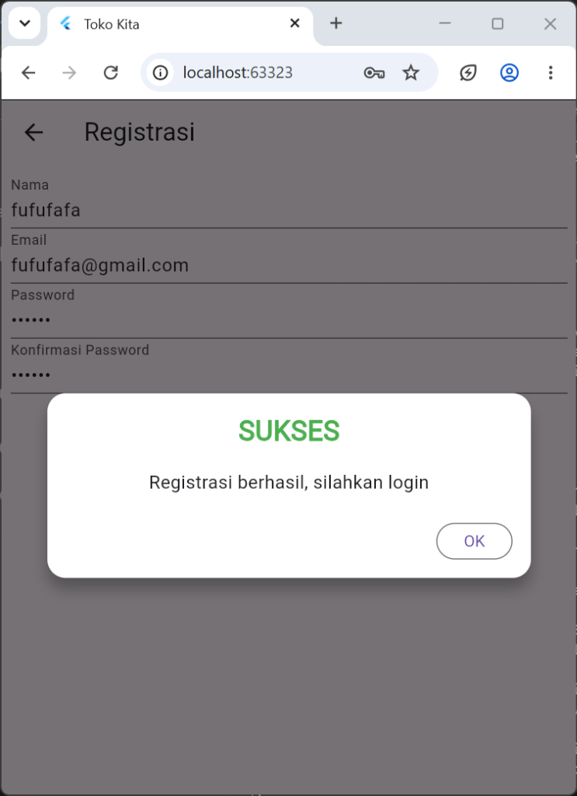 | 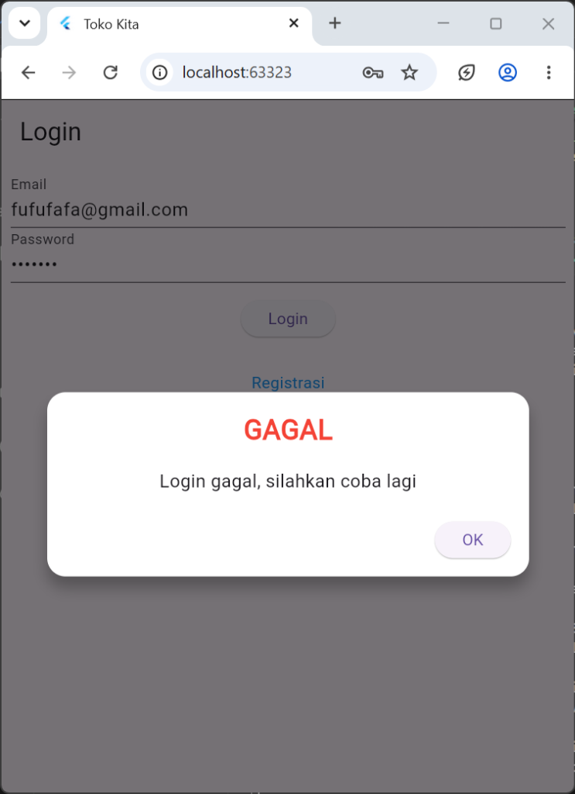 |

| List Produk (REST API) | Form Tambah Produk | Detail Produk |
| :---: | :---: | :---: |
| 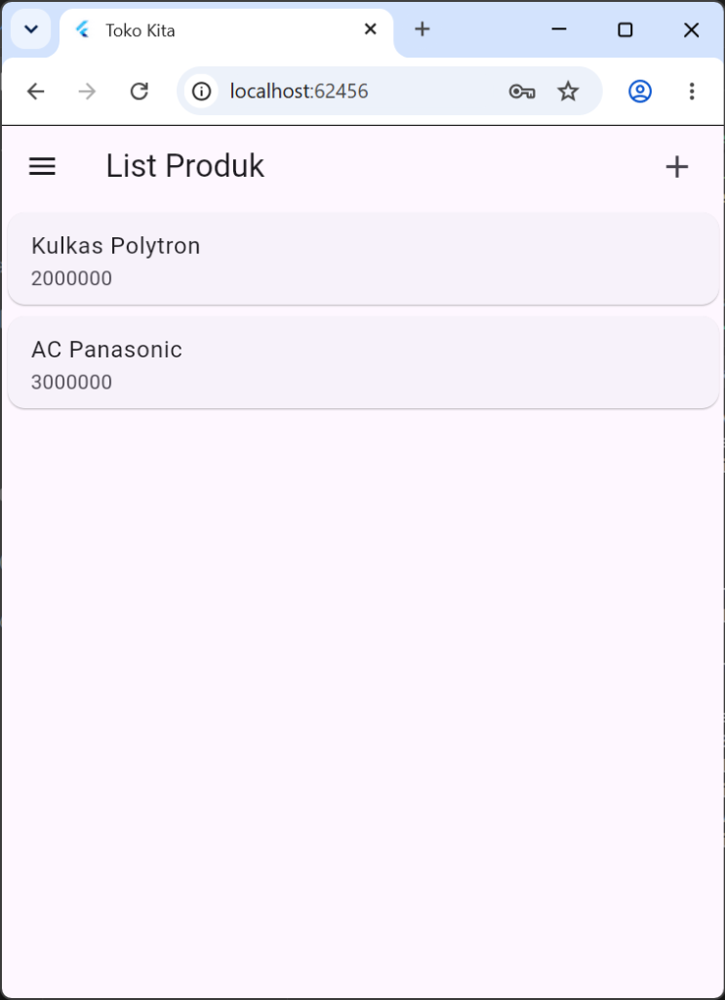 | 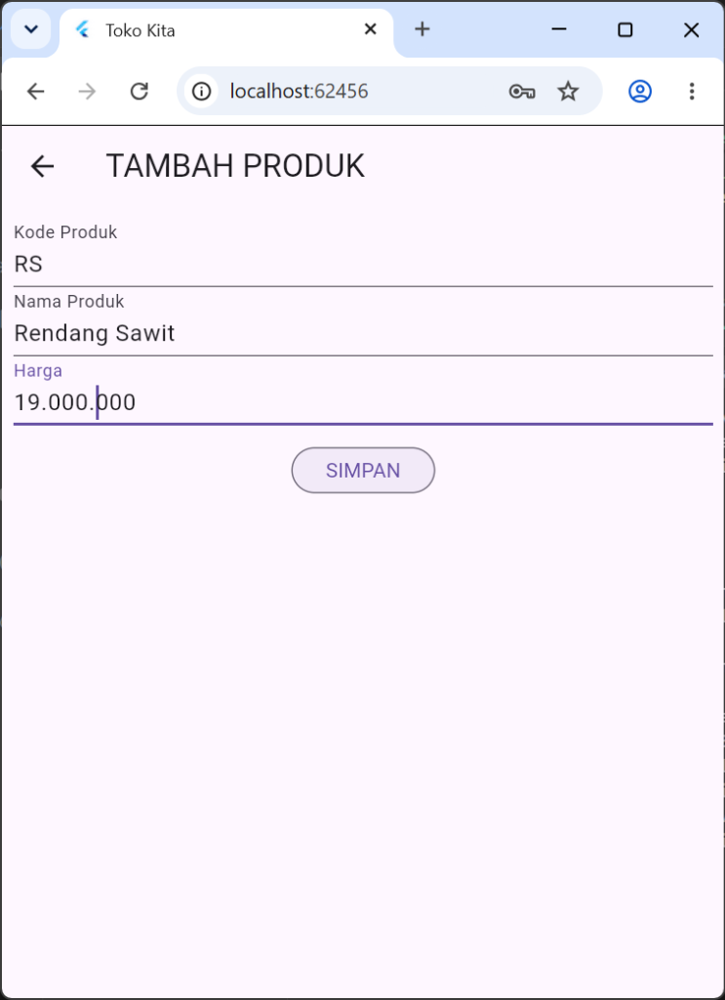 | 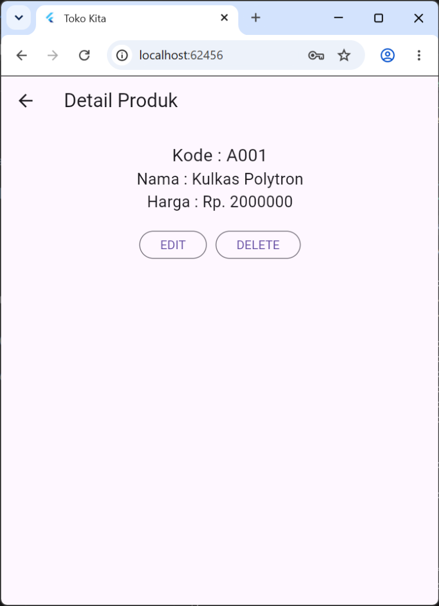 |

**Kesimpulan Praktikum:**  
Pada pertemuan kelima, praktikum membahas integrasi menyeluruh antara aplikasi Flutter dengan RESTful API CodeIgniter 4 dan database MySQL. Integrasi dilakukan melalui implementasi arsitektur **BLoC** (*Business Logic Component*) untuk memisahkan lapisan tampilan (*UI*) dengan logika bisnis serta komunikasi data. Praktikum mencakup:
1. **Helper & Network**: Pembangunan modul `Api` untuk penanganan HTTP Request (`GET`, `POST`, `DELETE`) dengan otentikasi `Bearer Token`, `ApiUrl` yang dinamis untuk lingkungan Web (*localhost*) dan Android Emulator (*10.0.2.2*), serta penanganan galat jaringan modular melalui `AppException`.
2. **Session Persistence**: Pemanfaatan `UserInfo` berbasis `shared_preferences` untuk menyimpan token dan user ID sehingga status autentikasi pengguna tetap terjaga saat aplikasi dibuka kembali.
3. **Komponen Dialog UI**: Pembuatan widget umpan balik modular `SuccessDialog` dan `WarningDialog` untuk menampilkan notifikasi sukses atau gagal pada proses registrasi, login, dan modifikasi data produk.
4. **CRUD Integration**: Menghubungkan antarmuka `ProdukPage` (menggunakan `FutureBuilder`), `ProdukForm` (tambah/edit dengan sanitasi input harga), dan `ProdukDetail` (hapus produk) ke endpoint API secara *real-time*.
