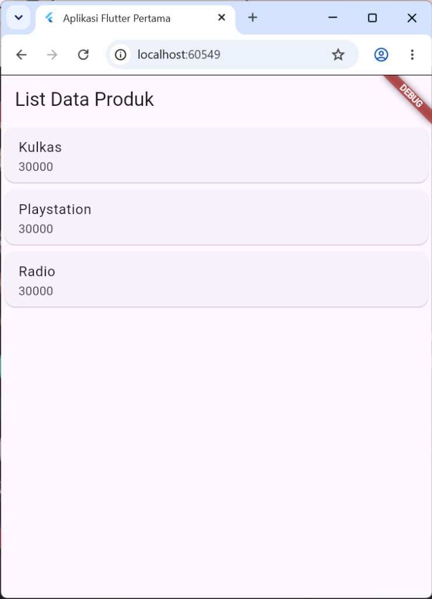
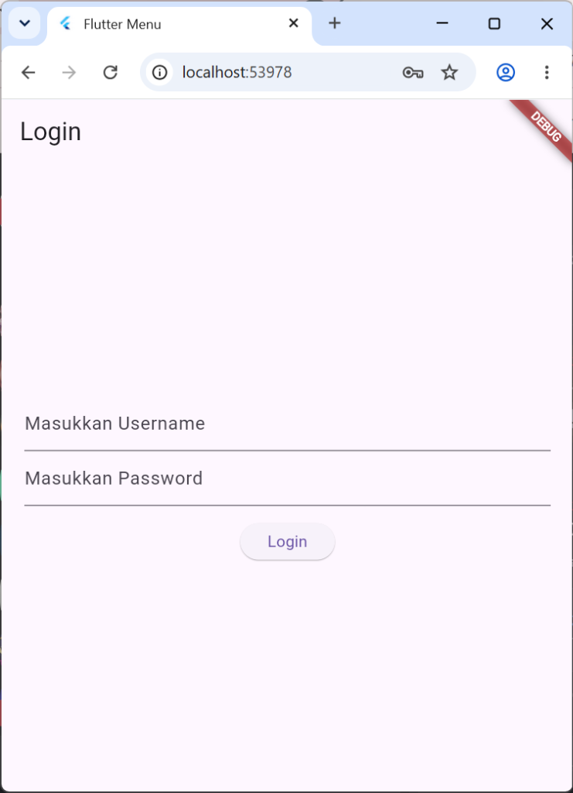
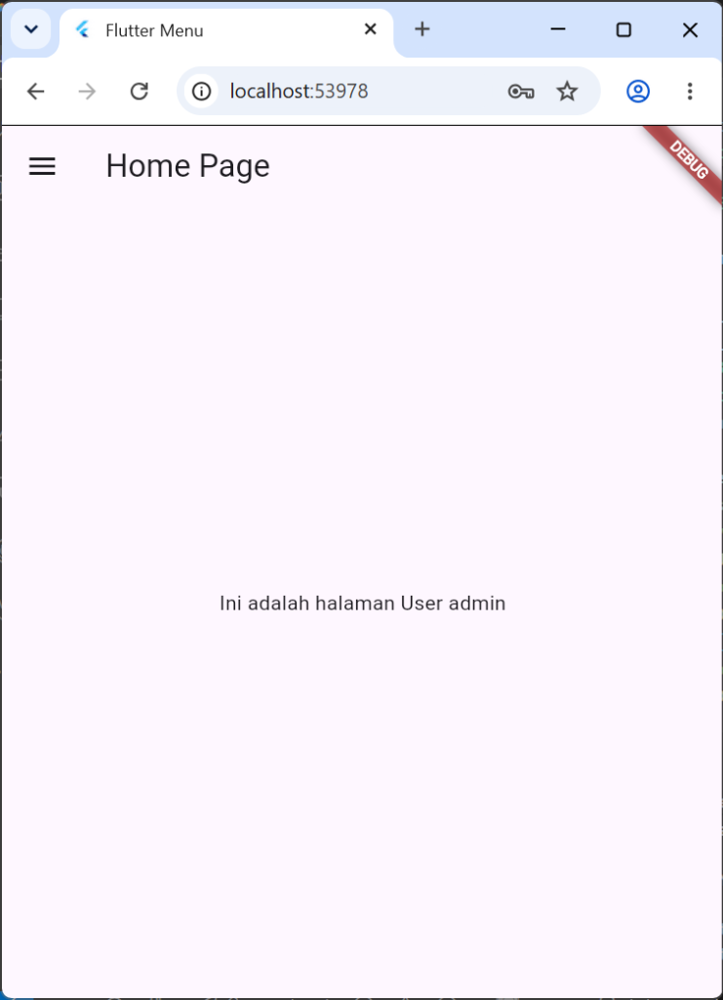
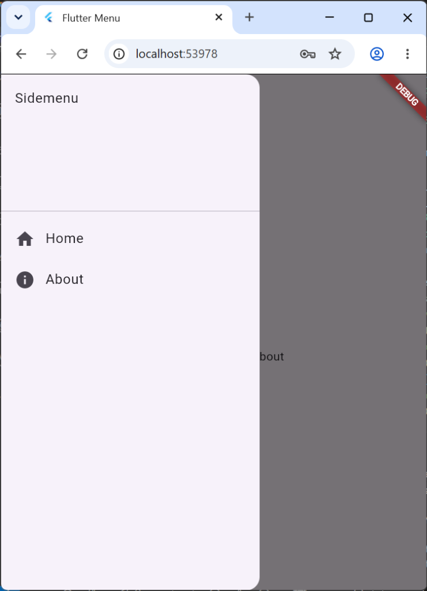
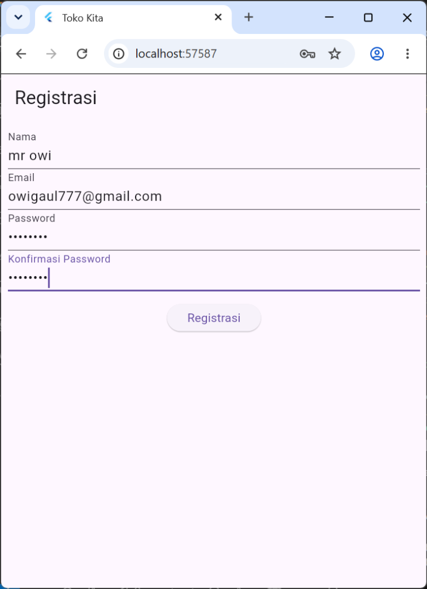
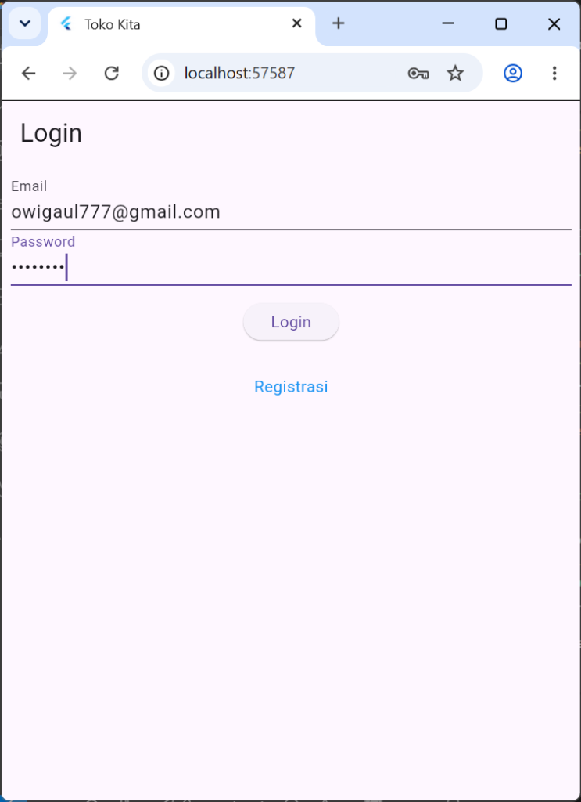
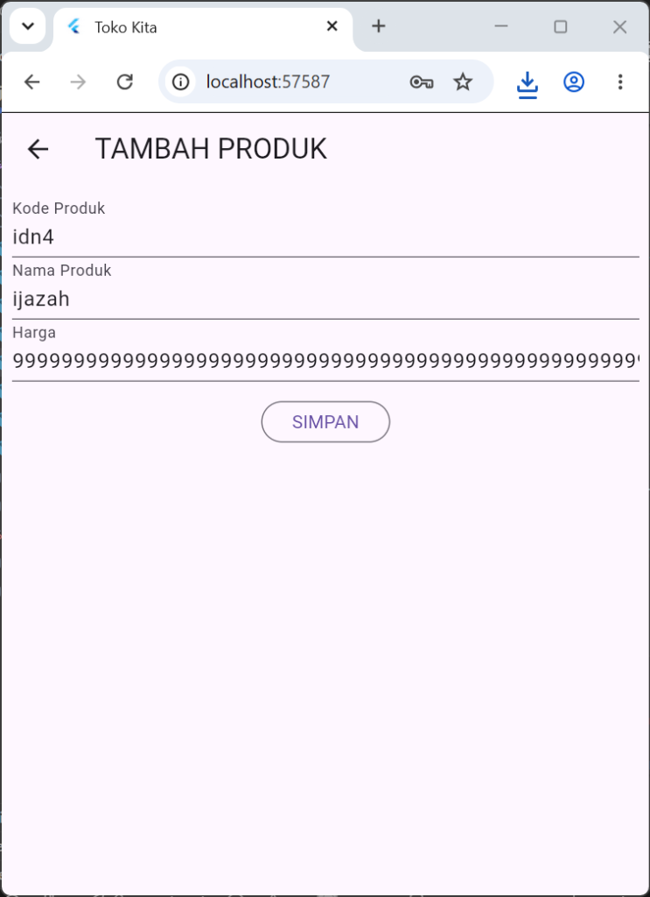
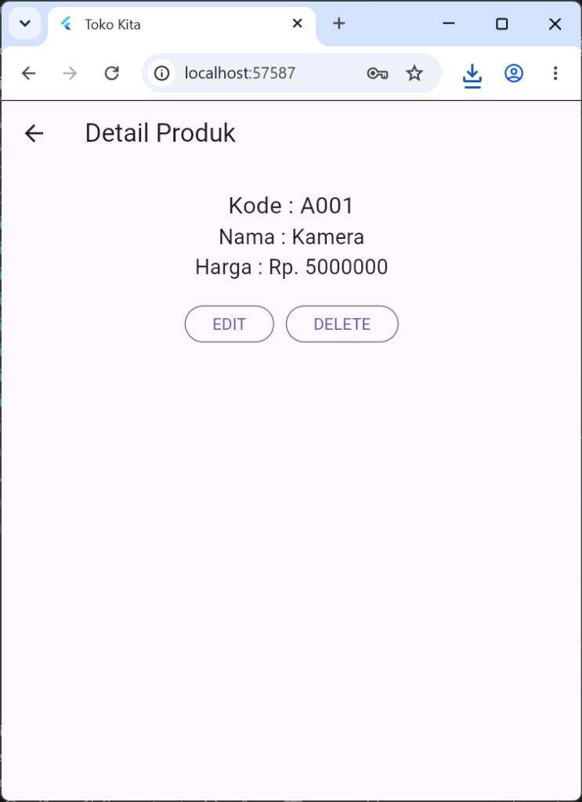

# Laporan Praktikum Pemrograman Mobile

**Nama**        : Afkar Aufaa Farros  
**NIM**         : H1D024085  
**Shift**       : Awal E / Akhir C  
**Praktikum**   : Pemrograman Mobile

---

## 📝 Tugas Pertemuan 2
**Tanggal**: Selasa, 27 Oktober 2026

**Kesimpulan Praktikum:**  
Pada pertemuan kedua, praktikum mempelajari konsep dasar antarmuka pengguna (*User Interface*) dan pengaturan tata letak (*layout*) pada Flutter. Materi mencakup penggunaan widget tata letak dasar seperti `Row` dan `Column`, pembuatan antarmuka formulir input produk dengan `TextField`, serta penyajian data produk ke dalam bentuk daftar yang terstruktur dan rapi menggunakan `ListView`, `Card`, dan `ListTile`.

---

## 📝 Tugas Pertemuan 3
**Tanggal**: Selasa, 3 November 2026

| Login Page | Home Page | Side Menu |
| :---: | :---: | :---: |
|  |  |  |

**Kesimpulan Praktikum:**  
Pada pertemuan ketiga, praktikum membahas tentang navigasi routing (*Routes*), pembuatan menu samping (*Side Menu / Drawer*), sistem otentikasi sederhana (*Login*), serta penyimpanan data lokal menggunakan *package* `shared_preferences`. Melalui praktikum ini, mahasiswa mempelajari cara mengelola form login, menyimpan dan membaca data username dari *local storage*, serta menghubungkan navigasi antarhalaman menggunakan `Navigator.push` dan menu navigasi `Drawer` pada aplikasi Flutter.

---

## 📝 Tugas Pertemuan 4
**Tanggal**: Selasa, 10 November 2026

| Halaman Registrasi | Halaman Login |
| :---: | :---: |
|  |  |

| Form Tambah Produk | Detail Produk |
| :---: | :---: |
|  |  |

**Kesimpulan Praktikum:**  
Pada pertemuan keempat, praktikum mempelajari pembangunan layanan RESTful API menggunakan framework CodeIgniter 4 dengan database MySQL (`toko_api`) serta pengujian endpoint menggunakan Postman. Selain sisi backend, mahasiswa juga merancang model data (`Login`, `Registrasi`, `Produk`) dan antarmuka aplikasi *Toko Kita* di Flutter meliputi halaman Registrasi dengan validasi input, halaman Login, List Produk, Detail Produk, serta Form Tambah dan Ubah Produk.
